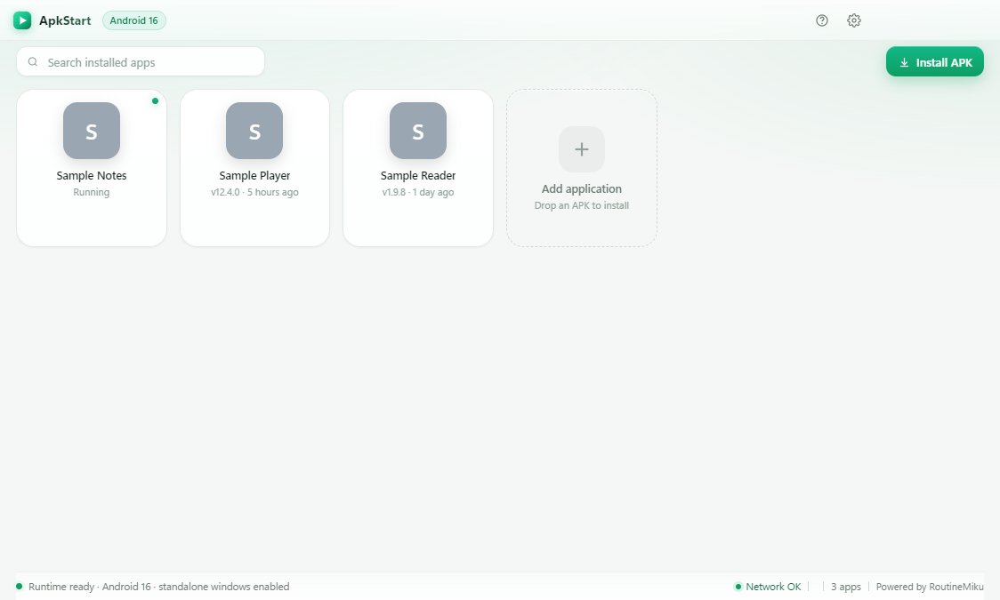
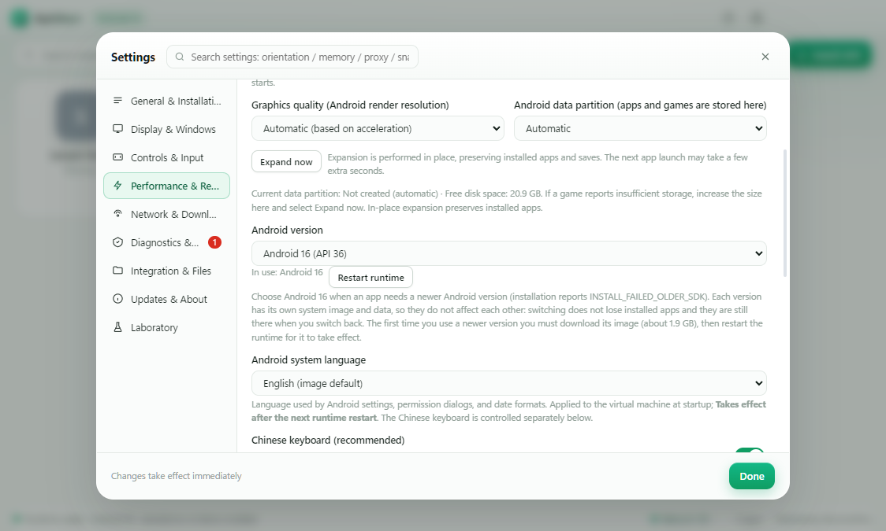
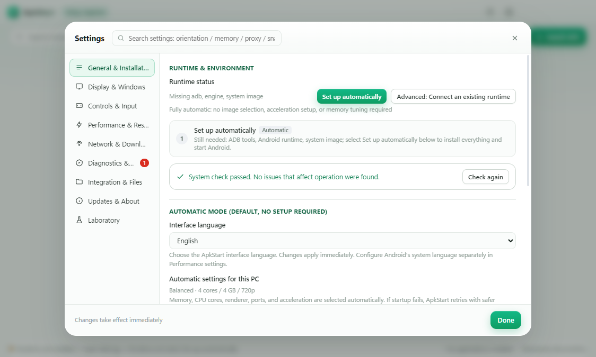

# ApkStart

**English** · [简体中文](README.zh-CN.md) · [ไทย](README.th.md)

<p align="center"></p>

[](LICENSE)
[](#)

**An Android app runner for Windows. Install and use Android apps like native Windows software.**

> **About this fork.** This is a fork of [RoutineMiku/apkstart](https://github.com/RoutineMiku/apkstart), an open-source project by RoutineMiku (MIT license). The fork adds an English-first interface with Thai, an English and Thai user guide, selectable Android versions (14 or 16), and a few fixes. The original README is kept as [README.zh-CN.md](README.zh-CN.md), and the changes are listed in [CHANGELOG.md](CHANGELOG.md).
>
> Note from the original author: this is an early-stage project made for fun in spare time (evenings and days off). It is open source and free, has no ads, and is not very polished yet.

- 🖱️ **Double-click an .apk to install.** After you register the .apk file association, double-clicking an APK in File Explorer parses it, installs it and creates a desktop icon. You never have to open an emulator window.
- 🧩 **One desktop icon per app.** The icon is extracted offline from inside the APK and converted to a multi-size ICO. Double-clicking the icon opens the app directly, just like a native Windows program.
- 🪟 **An app is just a window.** The runtime starts in **windowed** mode (in headless mode Android produces no VSYNC, so the app process is alive but the screen stays empty). ApkStart renames that window, gives it the real app icon and sets it up with a portrait aspect ratio, so it behaves as a standalone app window. **Fullscreen** fills the screen height and centers the app; **window mode** can be dragged and resized freely and remembers its size per app.
- 🔍 **Searchable in Windows.** After installation, shortcuts are created on the desktop and in the Start menu (`Programs\ApkStart\`). Search for the app name in the Start menu to launch it, and the taskbar groups windows by app.
- 📁 **Two-way file sharing.** `%USERPROFILE%\ApkStartShared` ↔ `/sdcard/ApkStartShared` inside Android stay in sync continuously. Files saved by Android apps appear on your PC.
- 🪶 **Very lightweight.** The shell has zero third-party dependencies (even the ZIP / PNG / ICO / AXML parsing is hand-written). The runtime starts on demand and shuts down when idle. You can also reuse an Android runtime that is already on your PC at no extra cost.
- 🌍 **Interface languages.** English is the default, and Thai and Simplified Chinese are supported. Other languages appear in the language list with partial translations.
- 🤖 **Choose the Android version.** Android 14 (default) or Android 16, each with its own system image and data. Pick Android 16 for apps that require API 36 (see [Android versions](#android-versions)).


> The screenshots in this README show the interface with sample data.


```
┌────────────────────────────────────────────────────────────┐
│  Desktop icon (.lnk with the real app icon)                │
│      │  double-click                                       │
│      ▼                                                     │
│  ApkStart.exe --launch <package name>                      │
│      │  runtime not running? → started automatically      │
│      │    (Android Emulator + API 34 or 36)                │
│      ▼                                                     │
│  Open via the LAUNCHER entry resolved by the system        │
│    (not the main Activity written in the APK)              │
│      │  watch for 18 s; on a crash, retry / reset data /   │
│      │  grant missing permissions automatically            │
│      ▼                                                     │
│  Emulator window = app window                              │
│    (title, icon, portrait ratio, fullscreen centered)      │
└────────────────────────────────────────────────────────────┘
```

## Getting it

This fork has **not published any release yet**, so you build it from source in one step (see [Build from source](#build-from-source)):

```powershell
git clone https://github.com/thfagjeen/apkstart.git
cd apkstart
.\build-exe.bat
```

This produces `dist\ApkStart-win64-portable\ApkStart.exe`. On first launch ApkStart downloads the Android runtime (the emulator, platform-tools and the Android 14 system image) from Google's official servers.

The prebuilt packages published by the original project work too, but their interface is Chinese by default and they do not include this fork's changes:

- GitHub: [github.com/RoutineMiku/apkstart/releases](https://github.com/RoutineMiku/apkstart/releases)
- Gitee: [gitee.com/daily-miku/apkstart/releases](https://gitee.com/daily-miku/apkstart/releases) (much faster to reach from China)

The original project ships these package types (same content and version number):

| Edition | File name | When to choose it |
|---|---|---|
| Store edition | `ApkStart_<four-part version>_x64.msix` | Install from the Microsoft Store. Includes the full runtime, needs no network after installation, updates are handled by the Store |
| Full portable edition | `ApkStart-v*-win64-full.zip` (about 830 MB, about 1.3 GB extracted) | You do not want to install or wait for downloads: extract and run, with the runtime inside the package |
| Installer edition | `ApkStart-v*-Setup.exe` (about 1.3 GB) | You want desktop / Start menu shortcuts and an uninstall entry |
| Lightweight portable edition | `ApkStart-v*-win64-portable.zip` (96 MiB, about 227 MB extracted) | You just want to try it first; the runtime is downloaded on first launch |

> All editions of `ApkStart.exe` carry the **brand icon and version resources** (FileDescription = `ApkStart Android app player`, CompanyName = `RoutineMiku`, version in sync with `package.json`), not the default Electron icon.
> To pack it yourself: `npm run pack` (lightweight) / `npm run pack:full` (full) / `npm run build:msix` (Store package), or double-click [`build-exe.bat`](build-exe.bat) in the project root.

### How the picture fills the screen

The **physical panel orientation of the emulator** (`hw.lcd.width/height`) is the real shape of the picture. When the panel orientation does not match the `screenOrientation` declared by the app, Android gives the app only a letterboxed strip in the middle with black bars on both sides. Resizing the window, changing `wm size` or changing the letterbox style cannot fill it (all combinations were tried; see the comments in `src/core/apk.js`).

So ApkStart **parses `AndroidManifest.xml` offline when the APK is installed** and works out whether the app is naturally landscape or portrait (weighted by the launch Activity; apps that are all `sensor` / `fullSensor` are asked once more after the first run). The result is stored in `apps.json`, and the panel is chosen from it at launch:

- A portrait app such as a short-video app → portrait panel 720×1280, upright and full, density 190 (sw606dp) so it also gets the tablet layout.
- A landscape app such as a novel reader → landscape panel 1280×720, upright and full.

The runtime restarts only when the panel orientation does not match the app orientation (about 40 seconds, and the title bar shows a notice). After that, apps with the same orientation start instantly. The rotate button in the title bar **remembers** the orientation for that app (other apps are not affected). You can switch to "Force landscape / Force portrait" under Settings → Display & Windows → Screen orientation.

The layout is decided by the "logical density": a width of 720 at 190 dpi equals **606 dp**, which is just above Android's 600 dp tablet breakpoint. The two-column episode page of short-video apps and the split-pane settings screens appear only at this density (the image default of 320 dpi gives only 360 dp, a phone layout). This is the "Tablet layout" switch in Settings. It is on by default; turn it off to return to the phone layout.

### Online updates

Settings → **Software updates** → "Check for updates", or tray right-click → "Check for updates". When a new version is found, click "Update now".

> **This fork checks only its own releases.** The in-app updater looks only at the GitHub Releases of this fork (`thfagjeen/apkstart`), not at the original project and not at Gitee, so an update can never overwrite the fork's changes with the original package. The Android runtime download on first launch still uses the original project's runtime package, because this fork does not host it. The rest of this section describes the behavior of the original project.

- The installer edition downloads `ApkStart-v*-Setup.exe` and installs it silently.
- The lightweight edition downloads `ApkStart-v*-win64-portable.zip`, extracts it and overwrites the **program folder**. The runtime folder (`%APPDATA%\apkstart\runtime`), installed apps and snapshots are not in the program folder, so updating loses nothing.
- The replacement is done by a separate PowerShell script (wait for the main process to exit → overwrite → relaunch). **There is no "please close the program manually" prompt**, and no emulator window is left on the desktop.

The update path is not hard-wired to GitHub. It **measures and chooses again every time**:

1. It asks GitHub and Gitee for the latest version at the same time and takes the higher one (one source timing out or being blocked does not affect the other).
2. It lists the candidates "direct from the origin / same-named asset on Gitee / mirror prefixes" and really downloads 256 KB from each address to measure speed. Only the throughput **after the first byte** is counted (handshake time is excluded, otherwise a high-latency, high-bandwidth source would be misjudged as slow).
3. It sorts by measured speed and downloads from the fastest source in parallel chunks, switching to the next source automatically on failure.

"Download & update sources" in the settings can force one side only (useful when a corporate network allows a single domain), turn off the public acceleration mirrors, or use your own mirror prefix. Gitee attachments are limited to 100 MB per file, so the portable package is compressed with 7-Zip deflate (`-mx=9`) to **95.0 MB**, and on Gitee it is a single file you can extract with a double-click (it used to be split into `.part1/.part2`, which is no longer done). The same-named packages of the two sources are not byte-identical, so the client picks one source from the speed test and downloads everything from it; it never mixes the two.

Both repositories are public, and the Gitee release list can be read anonymously, so no token is needed. (A read-only token in the settings is needed only to raise the quota when Gitee rate-limits you with 403/429.)

**Defaults that work out of the box** (nothing to hunt for in the settings):

- Starts with Windows and stays in the tray. Double-click a desktop icon to enter the app directly.
- After an APK is installed, shortcuts are created on **both the desktop and the Start menu**, so Windows search finds the app name. Shortcuts missing from older versions are restored on startup.
- App windows are natively rendered (not screen-cast). **Fullscreen** fills the screen height and is centered, keeping the phone aspect ratio. **Window mode** stays portrait, can be dragged and resized freely and remembers its size per app. Press `F11` or right-click the tray icon to switch at any time.
- Runtime permissions requested by an app are granted automatically after installation, so it does not get stuck on a system permission dialog. A crashing app is retried and, if needed, its data is reset before it is launched again.
- **The network uses the host's network directly.** On the Android side QEMU's user-mode NAT is used and the outgoing traffic reuses the physical network adapter of the PC. **No virtual network adapter or virtual switch is created on Windows** (no driver to install and no extra adapter). Nothing needs to be downloaded again and no network setting needs to change.

## Settings: categorized and searchable

The settings kept growing, so since 0.6.0 the settings page is split into eight categories by purpose, with a navigation column on the left:

| Category | What it holds |
|---|---|
| General & Installation | Runtime & environment, set up automatically, start with Windows, disk usage and cleanup |
| Display & Windows | Display mode, automatic fullscreen, screen orientation, automatic rotation, tablet layout, window mode, Android system settings |
| Controls & Input | Mouse buttons, keyboard mapping (game controls) |
| Performance & Resources | Resource profile, graphics quality, **Android version**, data partition, Android system language, Chinese keyboard, snapshots, warm-up at startup, advanced parameters |
| Network & Downloads | Update and download sources, public acceleration mirrors, number of download connections |
| Diagnostics & Repair | System check · automatic configuration, drivers · compatibility patches, automatic checks · smart diagnostics |
| Integration & Files | Desktop & applications, file sharing, system integration |
| Updates & About | Software updates, about |

There is also a search box at the top. Type words such as "landscape", "memory" or "proxy" and the matches are shown **across categories**, so you never "find something but cannot see it". The last category you visited is remembered and is open again the next time.

## Android versions



ApkStart runs one universal **Google Play x86_64** system image. You can choose which one under Settings → Performance & Resources → **Android version**:

| Version | API | Notes |
|---|---|---|
| Android 14 (default) | 34 | The image ApkStart has always used (about 1.4 GB to download). |
| Android 16 | 36 | For apps that require a newer Android (installation reports `INSTALL_FAILED_OLDER_SDK`). About 1.8 GB to download. |

- **Each version has its own image and its own data.** Android 14 keeps the existing `apkstart` virtual device, Android 16 uses `apkstart36`. Switching never wipes anything: apps you installed on one version are still there when you switch back.
- Choose the version, download its image with the button next to the setting (first use only), then restart the runtime.
- If you choose a version whose image is not downloaded yet, ApkStart keeps using Android 14 instead of failing.
- Verified on a real machine: Android 16 boots in about 30 seconds, installs and runs apps with `minSdk = 36`, and includes the ARM translation layer.
- The real-boot check is available as `node tools/e2e-android-version.js --api 36 --apk <file> --pkg <package>` (close ApkStart first).

## Automatic checks (auto debug)

Settings → **Diagnostics & Repair** → "Automatic checks · Smart diagnostics". In the background it checks the PC on a schedule and lists problems by category:

- **Runtime**: the real reason the last startup failed, a stuck boot, leftover lock files, orphan emulator processes, empty-shell snapshots, no hardware acceleration
- **Device connection**: adb not authorized (Android showed "Allow USB debugging?" and nobody clicked it), offline, runtime running but adb cannot see the device
- **Storage**: free disk space, a data partition setting that does not match the real size (the overlay disk blocks expansion), shared folder not writable
- **Settings**: screen orientation policy conflicting with the physical panel, automatic fullscreen not taking effect in standalone windows
- **Network / logs**: no network on the Android side, download sources unreachable, errors in recent logs

Every problem can be fixed in one click (restart the runtime, clear locks, clear orphan processes, invalidate the snapshot, clean up disk, reset the Android network...). After a fix it re-checks automatically.

Two principles: **a failed probe is never treated as a problem** (if the state cannot be read it reports "unknown" and never guesses), and **you are notified once when a new problem appears** (old problems do not nag, and a recovered problem is recorded silently). The default interval is 10 minutes; turn it off or change it on the same page.

## User guide

A full user guide with troubleshooting is built into the app (the `?` button in the title bar, or Settings → About → "Open user guide and troubleshooting"). It opens in the language you selected and jumps straight to the section that matches the current problem.

- English: [docs/USER-MANUAL.en.md](docs/USER-MANUAL.en.md)
- ไทย: [docs/USER-MANUAL.th.md](docs/USER-MANUAL.th.md)
- 简体中文: [docs/USER-MANUAL.md](docs/USER-MANUAL.md)

## Build from source

```powershell
# 1. Install dependencies (includes the Electron runtime)
npm install

# 2. Start it and finish the runtime setup (one-time download of adb / Android Emulator / system image)
npm start

# 3. (Optional) register the double-click-to-install .apk association
npm run assoc:on

# 4. Pack the portable edition (no installation, can be distributed directly)
npm run pack
# Output: dist/ApkStart-win64-portable/ApkStart.exe
# 5. Zip it for release (use this script, not Compress-Archive: the file would be 5 MB bigger and would not fit on Gitee)
node build/zip.js dist/ApkStart-win64-portable ApkStart-win64-portable.zip
```

> Shortcut: double-click [`build-exe.bat`](build-exe.bat). It installs the dependencies if they are missing and packs the portable edition in one step.
> `build-exe.bat full` builds the full edition (needs `build/runtime`). `build-exe.bat setup` is reserved for the `Setup.exe` installer, but see the version note below.

> **Version numbers.** This fork uses the original version plus a fourth number for the fork's own revision (`0.6.4.1` = the original 0.6.4, revision 1). A four-part number is not strict semver, so `electron-builder` refuses it and the `Setup.exe` installer cannot be built with it. The portable edition is not affected.

### Single-file EXE (full runtime inside, no network needed after installing)

If you want "send one EXE and the other person double-clicks to run it, with no waiting for downloads", use this:

```powershell
# First prepare engine/ as a distributable runtime (system.img is compressed with xz/LZMA2 at the highest level, 3.1 GB → about 1.1 GB,
# and the parts of the emulator that are not needed are removed: the arm64 QEMU, the Vulkan backend, language packs, qsn/self-test tools, VR resources)
npm run runtime

# Then pack an installer EXE (the nsis target of electron-builder, installs into the current user's folder)
npm run build:exe
# Output: dist/release/ApkStart-<version>-Setup.exe
```

Size breakdown (measured): Electron about 180 MB, the emulator after slimming about 480 MB, the system image after xz compression about 1.1 GB, for an installer of about 1.32 GB (about 490 MB less than the gzip approach). The hard floor is the system.img itself (it is the Android system, and a verity-protected image from which the GMS components cannot be removed from the outside). The network goes through the host NAT by default and no virtual network adapter is created, so no extra driver is needed either.

On first launch the xz image is extracted to `%APPDATA%\apkstart\system-images` (about 20 seconds, once) and reused afterwards. The AVD and installed apps always live in `%APPDATA%\apkstart\avd`, so they survive even if the portable edition is extracted to a temporary folder every time.

## About the runtime: fully independent, no third-party emulator

ApkStart is a **self-contained** project. All runtime components are downloaded, verified and managed by itself (under `%APPDATA%\apkstart\runtime`). The lightweight edition first downloads the whole package from **the original project's GitHub Release** (`ApkStart-runtime-*.zip`) and falls back to the official sources in the table below only if that fails:

| Component | Source | Size | Used for |
|---|---|---|---|
| adb (platform-tools) | official dl.google.com | ~8 MB | Installing / launching Android apps |
| Android Emulator | official dl.google.com (8 parallel connections) | ~440 MB | The runtime engine (with its own device models and GPU translation) |
| Android system image (Google Play x86_64), Android 14 or 16 | official dl.google.com | ~1.4 GB (Android 14) / ~1.8 GB (Android 16) download | The only base layer: x86 apps, ARM-only apps and GMS all run on it; the image is the system, nothing to install |
| AEHD driver (optional) | official dl.google.com | ~0.2 MB | Hardware acceleration (or use Windows "Virtual Machine Platform" through WHPX) |

On first use the "Runtime" page guides you through the setup above (**one-click setup**):
1. adb, the runtime engine and the system image are downloaded automatically (measured at 10+ MB/s from the official sources);
2. When the setup is done it **boots automatically**, and from then on double-clicking a desktop icon starts everything without you noticing.



**Device compatibility (handled automatically, nothing for you to do)**

- Without hardware acceleration it falls back to software emulation automatically. If startup fails it retries automatically with up to 4 parameter sets, in the order "renderer → acceleration method → memory / cold boot".
- `-gpu` is chosen automatically by engine version (37.x uses `software`, older versions use `swiftshader_indirect`), and deprecated modes are no longer used.
- Memory and core count are derived from the physical memory (2–4 GB / 2–4 cores), the data partition went down from 16 GB to 4 GB, ports are picked dynamically from the free ones, paths with Chinese characters are converted to short paths and AVD lock files are cleaned up automatically.
- Failure reasons are translated into plain language with repair suggestions, and the settings can "Export diagnostic report".
- Large downloads use **8 chunked connections with resume** by default, and fall back to a single stream for sources without Range support.
- **It uses only its own runtime and has nothing to do with other emulators.** ApkStart does not detect, take over or drive MuMu / LDPlayer / BlueStacks / WSA on your PC. Whether you have them installed, how they upgrade and how their ports change does not affect ApkStart. The settings no longer offer an "engine switch" either.
- **System check · automatic configuration.** After installation it first checks CPU virtualization (VT-x/SVM), the Windows hypervisor platform, the graphics card and video memory, and the memory and system version. Whatever it can change itself (memory / cores / graphics quality / renderer) is written straight into the settings and saved as a driver; anything that needs administrator rights gets a button, and anything that can only be changed in the BIOS is explained to you. See [docs/preflight.md](docs/preflight.md) (Chinese).
- **Driver (compatibility patch) extension.** If a machine needs different startup parameters to run (an older GPU with a low GLES version, hardware acceleration not enabled, a driver version that crashes as soon as hardware rendering is on), you can write a JSON patch that declares which machines it matches and which parameters to change once it matches. The settings page can import and enable patches and export a template for this PC. A patch can only change items on an allowlist of startup options and never executes any code. See [docs/drivers.md](docs/drivers.md) (Chinese).

**Container-style, low-cost operation**

- **Read-only base layer.** `system-images/` holds one copy for the whole PC, shared by all apps, instead of keeping an AOSP image and a compatibility image side by side.
- **Thin writable layer.** A single AVD uses a differential user-data layer plus a named quickboot snapshot. When the last app window closes (while idle), the memory state is saved as a snapshot and the next boot restores it instead of cold-booting.
- **Idle warm-up (on by default).** Like WSA, ApkStart boots the Android environment in the background as soon as it starts (the window stays hidden the whole time), so opening an app is down to a single `am start`. The price is about 1 GB of resident memory while idle, and you can turn it off in the settings.
- **Faster cold start.** The acceleration and engine-version probe results are cached on disk (invalidated by the exe fingerprint), pointless `wmic` process enumeration is skipped, the boot probe uses an adaptive interval (starting at 350 ms), and the guest-side preparation commands are merged into one adb round trip. A start waits 5–10 seconds less.
- **`/data` is built by ApkStart itself.** The `userdata.img` in the official system image is only a 1 MB all-zero placeholder, and the real formatting is normally done by the SDK tools. Launching `emulator.exe` directly skips that step, so `/data` cannot be mounted and the guest falls into a recovery restart loop, which looks like "waiting several minutes and it still will not open". On first launch it now generates a 4 KB-block ext4 with `ENCRYPT` (file-based encryption) and `ext_attr` (SELinux labels) itself, and grows it to the configured size with the bundled `qemu-img` + `resize2fs`. Measured: cold start ~23 s, snapshot hit ~10 s.
- Snapshot integrity checks: the empty shell left by an interrupted save (a `snapshot.pb` of only a few dozen bytes) is detected and cleaned up. Newer emulators write `ram.bin` (older ones write `ram.img`) and both names are recognized, so a freshly saved 3 GB snapshot is no longer mistaken for an empty shell and deleted.
- **No command windows at all.** The console window of qemu belongs to `conhost.exe`, whose pid does not match qemu's, so a pid allowlist cannot hide a single one of them, and the emulator's network daemon `netsimd` even pops up its own black window. It now turns on a resident suppressor **before** the emulator starts, backs it up by window class name / title (emulator / qemu / netsim) and scans every 120 ms during the first 90 seconds after boot.
- **Opening the program shows only the program's own window.** The emulator main window (`Android Emulator - apkstart5554`) never appears alone on the desktop: it is either suppressed and hidden, or already embedded in the app window with `SetParent`. When an app window is closed, the emulator window is **first** detached from the host window and hidden, **then** the host is destroyed (the other order makes Windows reattach it to the desktop and show it). After the app exits, the window agent keeps watching for up to 3 more minutes, so an emulator that was quit in the middle of booting cannot light up a black window a few dozen seconds later.
- **Download on demand.** The universal image is fetched when an app with only ARM native libraries shows up. `.apks` / `.xapk` split packages are installed automatically with `install-multiple`.
- **Reclaimable.** Non-x86_64 QEMU targets are removed at build time (about 400 MB), and the settings page can clean up old images, old snapshots, lock files and leftover AVDs.

## Project layout

```
apkstart/
├─ src/
│  ├─ main.js              Main process: windows / tray / single instance / command-line dispatch / IPC
│  ├─ preload.js           Secure bridge
│  ├─ ui/                  Renderer (plain HTML/CSS/JS, no framework); i18n.js holds the translations
│  └─ core/
│     ├─ zip.js            Minimal ZIP reader (extracts on demand)
│     ├─ axml.js           Android binary XML parser
│     ├─ arsc.js           resources.arsc table parser (recovers app names / icon paths)
│     ├─ apk.js            APK metadata: package name / version / launch Activity / icon / ABI
│     ├─ png.js            Dependency-free PNG encoder + program icon drawing
│     ├─ shortcut.js       Multi-size ICO generation + .lnk shortcuts
│     ├─ assoc.js          .apk file association (HKCU, no administrator rights)
│     ├─ adb.js            adb client (install / launch / sync / screenshot / ...)
│     ├─ engine.js         Runtime management: detection / emulator hosting / idle reclaim
│     ├─ provision.js      Downloads and checks runtime components, per-Android-version images
│     ├─ sharer.js         Two-way sync between the PC and the Android shared folders
│     ├─ installer.js      Installation pipeline orchestration
│     ├─ manual.js         Built-in user guide: problem → section mapping, language selection
│     └─ store.js          Persistent app list and settings
├─ engine/                 Download cache of runtime components (emulator / system-images / platform-tools)
├─ tools/                  Developer tools (real-boot tests, update checks, ...)
├─ docs/                   Documentation (the user guide is in English, Thai and Chinese)
├─ test/                   Unit tests + Electron integration tests + smoke screenshots
├─ build/pack.js           Portable edition packing
├─ build-exe.bat           One-click build script (installs dependencies + packs)
└─ scripts/assoc.js        Command-line switch for the .apk association
```

## Command line

```
ApkStart.exe                      Open the main window
ApkStart.exe <path\to.apk>        Install an APK
ApkStart.exe --launch <package>   Launch an app directly (desktop shortcuts use this)
```

## Tests

```powershell
npm test                                   # Pure-Node unit tests + engine pipeline tests (no network needed)
npm run test:ui                            # Settings page test in a real Electron window
npm run test:boot                          # Real boot test: a 61 MB Alpine guest checks the QEMU parameters / disk creation / graceful shutdown
npm run selftest                           # Runtime self-test: after Android is installed, verify install → launch → screenshot → shared folder in one go
electron test/electron-integration.js      # ICO / shortcut integration tests
electron . --smoke test\shot.png           # Start the app and take a screenshot (UI smoke test)
```

> On a machine that already has the Android runtime installed, one `test/engine-test.js` check ("needsSetup when no system is installed") fails because it assumes a clean machine. The other suites are unaffected.

`npm run selftest` is the "acceptance command" once the system is installed. It checks the current device in order: the adb connection, the Android version, freeform support and two-way sync of the shared folder, and with `--apk some-app.apk` it also walks through the whole flow of installing → launching in a standalone window → confirming it is in front → taking a screenshot.

## Design trade-offs (honestly)

- **It is not a hypervisor written from scratch.** The Android kernel, GPU translation and the ART runtime are years of engineering. This project chooses to stand on the shoulders of AOSP / QEMU / adb and puts the effort into the "native-app-level experience". This is the same architectural idea behind products such as Tencent MyApp PC and Google Play Games on PC.
- **The shared folder is synced, not mounted.** Without root, Windows cannot mount an NTFS folder inside Android, so a two-way sync within seconds gives an equivalent experience.
- **ARM-only apps.** The Android 14 / 16 Google Play images include the newer `ndk_translation` layer, so apps with only ARM native libraries install and run. **A free short-drama app (com.phoenix.read, arm64-v8a only) was measured to install, enter the recommendation feed and play video normally.** On the old API 30 image, the non-standard signal handler bundled with ByteDance apps triggered a protective assertion of the translation layer (`DoBadTrampoline` SIGABRT); the newer translation layer fixes it. A few apps have deeper anti-emulator checks (for example forcing verification of the real sensors or baseband) and may still be limited. When an installation fails or an app crashes on launch, ApkStart explains why.

| A free short-drama app in compatibility mode (Android 14 · AEHD hardware acceleration) |
|:---:|
|  |

### What if it says "Hardware acceleration is disabled"?

An Android emulator on Windows has only two ways to accelerate:

| Method | What it is | Who needs administrator rights | Restart needed after installing? |
|---|---|---|---|
| **WHPX** | The built-in Windows feature "Windows Hypervisor Platform" | When turning this feature on | Yes |
| **AEHD** | Google's own kernel driver | When installing the driver | No |

- **Installer / portable edition:** Settings → System check → click **Fix** to the right of "Hardware acceleration is disabled". A UAC prompt appears once and WHPX is enabled automatically. If it cannot be enabled (the system does not support it, or you clicked No), the AEHD driver is installed instead.
- **Microsoft Store (MSIX) edition:** Store apps **cannot elevate themselves**, so clicking Fix opens the "Turn Windows features on or off" dialog. Tick **"Windows Hypervisor Platform"** (HypervisorPlatform), confirm, then **restart the PC** once.

  You can also run this in an administrator PowerShell:

  ```powershell
  dism /online /enable-feature /featurename:HypervisorPlatform /all /norestart
  dism /online /enable-feature /featurename:VirtualMachinePlatform /all /norestart
  ```

> Do not enable only "Virtual Machine Platform (VirtualMachinePlatform)". That one is for WSL2, and what the emulator needs is **"Windows Hypervisor Platform (HypervisorPlatform)"**. If you enable only the former, `emulator -accel-check` still reports it as unavailable.
>
> It also runs without acceleration (pure software emulation), but startup takes several minutes. That is the purpose of the notice in the app, and it is not a startup failure.

### A desktop icon is wrong / shows ApkStart's icon

The desktop shortcut of every Android app should use **its own icon** (extracted from the APK at installation time and stored at `%APPDATA%\apkstart\icons\<package>.ico`). If it shows ApkStart's green play button or a blank icon:

1. **Settings → System integration → Rebuild shortcuts** (rewrites the desktop and Start menu shortcuts from the current app list, repairing the icon and the taskbar identity together);
2. If that does not help, delete the shortcut, then in ApkStart right-click the app → create the shortcut again / reinstall it.

> Why it breaks: early versions pointed the `IconLocation` of these `.lnk` files at ApkStart's brand icon when tidying icons. Also, if you move the whole portable folder somewhere else, the absolute path stored in the `.lnk` becomes invalid. Rebuilding once fixes it.
>
> By the way, the shortcut of every app carries its own AppUserModelID, so after you **pin it to the taskbar**, the taskbar button and the pinned item use the same app icon and are not mixed up with ApkStart.

### Why does my `adb devices` not see this Android device?

ApkStart's adb server runs on **dedicated port 5044**, completely separate from your own adb (5037). That way your Android Studio / scrcpy does not fight it for devices, and it never kills an emulator you started by hand.

To connect from the command line:

```powershell
$env:ANDROID_ADB_SERVER_PORT = 5044
adb devices              # you will see emulator-5554
```

⚠️ **Do not** run `adb connect` manually to port `5555`: the Play system image shows an "Allow USB debugging?" system dialog, and it appears on top of the running Android app, which looks as if the program is broken.

## About the author

ApkStart is developed and maintained by **RoutineMiku**. This fork is maintained by [thfagjeen](https://github.com/thfagjeen).

- Original project on GitHub: <https://github.com/RoutineMiku/apkstart>
- This fork: <https://github.com/thfagjeen/apkstart>

<p align="center"></p>

<p align="center"><i>Powered by <b>RoutineMiku</b></i></p>

## Contributing

Issues and PRs are welcome. The shell keeps zero third-party dependencies, so please run `npm test` before submitting; see [CONTRIBUTING.md](CONTRIBUTING.md) for details.

## License

[MIT](LICENSE). The release packages contain only ApkStart's own code and the Electron runtime. They do not distribute Android system images, QEMU binaries or Google components; these are downloaded on demand from the official sources on the user's own machine at first launch, under their own licenses.
