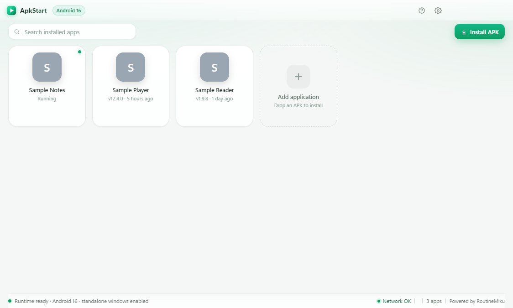
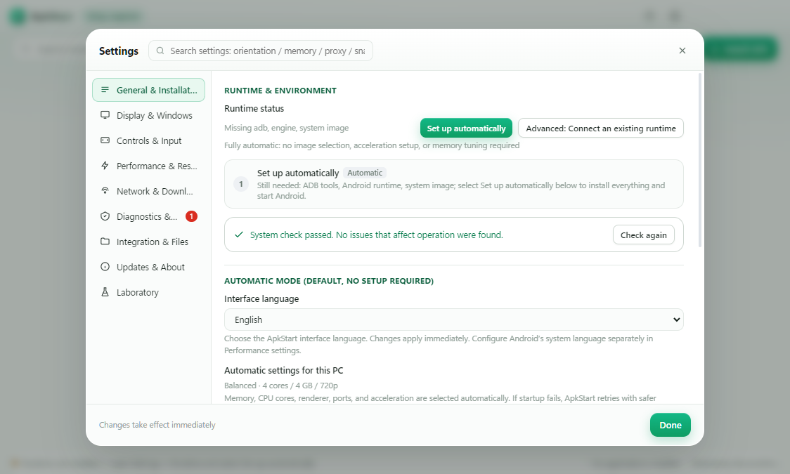

# ApkStart

[English](README.md) · [简体中文](README.zh-CN.md) · **ไทย**

> ไฟล์นี้เป็นฉบับแปลภาษาไทยของ README ภาษาจีนต้นฉบับ ([README.zh-CN.md](README.zh-CN.md)) และปรับให้ตรงกับ fork นี้ ฉบับอังกฤษคือ [README.md](README.md) หากเนื้อหาต่างกัน ให้ถือฉบับอังกฤษและฉบับต้นฉบับเป็นหลัก
> คู่มือการใช้งานฉบับไทย: [docs/USER-MANUAL.th.md](docs/USER-MANUAL.th.md) (ฉบับอังกฤษ: [docs/USER-MANUAL.en.md](docs/USER-MANUAL.en.md)) และคู่มือนี้ฝังอยู่ในโปรแกรม เปิดตามภาษาที่ตั้งไว้ เอกสารอื่นใน `docs/` ยังเป็นภาษาจีน

<p align="center"></p>

[](https://github.com/RoutineMiku/apkstart/actions/workflows/ci.yml)
[](https://github.com/RoutineMiku/apkstart/releases)
[](LICENSE)
[](#)

**ตัวเปิดแอป Android บน Windows — ติดตั้งและใช้งานแอป Android ได้เหมือนโปรแกรม Windows ทั่วไป**
หมายเหตุ: โปรเจกต์นี้เป็นเวอร์ชันแรกเริ่ม ผู้พัฒนาทำเพื่อความสนุกส่วนตัว การแก้ไขทั้งหมดทำหลังเลิกงานและวันหยุด เป็นโอเพนซอร์สและฟรี ไม่มีโฆษณา ตอนนี้ยังไม่ค่อยใช้งานง่ายนัก และไม่เคยจ้างบัญชีการตลาดโปรโมต

- 🖱️ **ดับเบิลคลิก .apk เพื่อติดตั้ง**: เมื่อลงทะเบียนการเชื่อมโยงไฟล์ .apk แล้ว ดับเบิลคลิก APK ใน File Explorer ระบบจะวิเคราะห์ → ติดตั้ง → สร้างไอคอนบนเดสก์ท็อปให้อัตโนมัติ โดยไม่ต้องเปิดอีมูเลเตอร์ใดๆ
- 🧩 **หนึ่งแอปหนึ่งไอคอนบนเดสก์ท็อป**: ไอคอนถูกดึงจากภายใน APK แบบออฟไลน์และแปลงเป็น ICO หลายขนาด ดับเบิลคลิกไอคอน = เปิดแอปนั้นโดยตรง ประสบการณ์เหมือนเปิดโปรแกรม Windows ทั่วไป
- 🪟 **แอปคือหนึ่งหน้าต่าง**: รันไทม์เริ่มทำงานในโหมด **มีหน้าต่าง** (ในโหมดไม่มีหน้าต่าง Android จะไม่ส่ง VSYNC โปรเซสของแอปยังมีชีวิตอยู่แต่หน้าจอว่างเปล่า) ApkStart จะเปลี่ยนชื่อหน้าต่าง สลับเป็นไอคอนจริงของแอป และจัดตำแหน่งตามสัดส่วนแนวตั้ง กลายเป็นหน้าต่างแอปที่เป็นอิสระ **โหมดเต็มหน้าจอ** ขยายเต็มความสูงของจอและจัดกึ่งกลาง **โหมดหน้าต่าง** ลากและปรับขนาดได้อิสระ และจำขนาดแยกตามแอป
- 🔍 **ค้นหาใน Windows ได้**: หลังติดตั้งจะสร้างทางลัดทั้งบนเดสก์ท็อปและเมนูเริ่ม (`โปรแกรม\ApkStart\`) พิมพ์ชื่อแอปในเมนูเริ่มก็เปิดได้ทันที และแถบงานจัดกลุ่มตามแอป
- 📁 **แลกเปลี่ยนข้อมูล**: `%USERPROFILE%\ApkStartShared` ↔ `/sdcard/ApkStartShared` ใน Android ซิงก์สองทางต่อเนื่อง ไฟล์ที่แอป Android บันทึกจะปรากฏในเครื่องทันที
- 🪶 **เบาสุดๆ**: ตัวเปลือกไม่พึ่งพาไลบรารีภายนอกเลย (แม้แต่การแยกวิเคราะห์ ZIP / PNG / ICO / AXML ก็เขียนเอง) รันไทม์ถูกเรียกขึ้นมาเมื่อต้องใช้และคืนทรัพยากรอัตโนมัติเมื่อว่าง หรือจะใช้รันไทม์ Android ที่มีอยู่ในเครื่องซ้ำก็ได้ โดยไม่กินทรัพยากรเพิ่ม



```
┌────────────────────────────────────────────────────────────┐
│  ไอคอนบนเดสก์ท็อป (.lnk พร้อมไอคอนจริงของแอป)               │
│      │  ดับเบิลคลิก                                         │
│      ▼                                                     │
│  ApkStart.exe --launch <ชื่อแพ็กเกจ>                       │
│      │  รันไทม์ยังไม่เริ่ม? → เริ่มอัตโนมัติ                 │
│      │    (Android Emulator + API34)                       │
│      ▼                                                     │
│  เปิดผ่านจุดเข้า LAUNCHER ที่ระบบวิเคราะห์ได้               │
│    (ไม่ใช่ Activity หลักใน APK)                            │
│      │  เฝ้าดูการอยู่รอด 18 วินาที ถ้าแครชจะลองใหม่ /       │
│      │  รีเซ็ตข้อมูล / เติมสิทธิ์ให้อัตโนมัติ                │
│      ▼                                                     │
│  หน้าต่างอีมูเลเตอร์ = หน้าต่างแอป                          │
│    (เปลี่ยนชื่อ เปลี่ยนไอคอน สัดส่วนแนวตั้ง เต็มจอกึ่งกลาง)  │
└────────────────────────────────────────────────────────────┘
```

## ดาวน์โหลดใช้เลย (ไม่ต้อง build เอง)

มีสองแหล่งที่เนื้อหาเหมือนกัน ผู้ใช้ในจีนแนะนำ Gitee:

- GitHub: [github.com/RoutineMiku/apkstart/releases](https://github.com/RoutineMiku/apkstart/releases)
- Gitee: [gitee.com/daily-miku/apkstart/releases](https://gitee.com/daily-miku/apkstart/releases) (เชื่อมต่อตรงในจีนเร็วกว่ามาก)

ตัวติดตั้ง (หลายรูปแบบ เนื้อหาและหมายเลขเวอร์ชันตรงกันทั้งหมด):

| รูปแบบ | ชื่อไฟล์ | เลือกเมื่อไร |
|---|---|---|
| รุ่น Store | `ApkStart_<เวอร์ชันสี่ส่วน>_x64.msix` | ติดตั้งจาก Microsoft Store มีรันไทม์ครบในตัว ติดตั้งเสร็จไม่ต้องใช้เน็ต การอัปเดตตัวเองให้ Store จัดการ |
| รุ่นพกพาเต็ม | `ApkStart-v*-win64-full.zip` (ประมาณ 830 MB แตกแล้วประมาณ 1.3 GB) | **ไม่อยากติดตั้งและไม่อยากรอดาวน์โหลด**: แตกไฟล์แล้วใช้ได้เลย รันไทม์ (อีมูเลเตอร์ + อิมเมจระบบ) อยู่ในแพ็กเกจทั้งหมด |
| รุ่นติดตั้ง | `ApkStart-v*-Setup.exe` (ประมาณ 1.3 GB) | ต้องการทางลัดบนเดสก์ท็อป/เมนูเริ่ม และรายการถอนการติดตั้ง |
| รุ่นพกพาน้ำหนักเบา | `ApkStart-v*-win64-portable.zip` (96 MiB แตกแล้วประมาณ 227 MB) | แค่อยากลองก่อน ดาวน์โหลดรันไทม์ตอนเปิดครั้งแรก |

> `ApkStart.exe` ทุกรูปแบบถูกฝัง **ไอคอนแบรนด์ + ข้อมูลเวอร์ชัน** ไว้แล้ว (FileDescription = `ApkStart 安卓应用运行器`,
> CompanyName = `RoutineMiku` เวอร์ชันตรงกับ `package.json`) ไม่ใช่ไอคอนเริ่มต้นของ Electron และเลขเวอร์ชัน `33.x` อีกต่อไป
> หากจะแพ็กเองจากซอร์ส: `npm run pack` (น้ำหนักเบา) / `npm run pack:full` (เต็ม) / `npm run build:msix` (แพ็กเกจ Store)
> หรือดับเบิลคลิก [`build-exe.bat`](build-exe.bat) ที่โฟลเดอร์รากของโปรเจกต์

### ภาพเต็มจอทำได้อย่างไร

**ทิศทางของจอจริงของอีมูเลเตอร์** (`hw.lcd.width/height`) คือรูปทรงจริงของภาพ เมื่อทิศทางของจอไม่ตรงกับ
`screenOrientation` ที่แอปประกาศไว้ Android จะให้แอปแค่แถบแคบๆ ตรงกลางแบบกล่องจดหมาย (letterbox) เติมดำสองข้าง
เปลี่ยนขนาดหน้าต่าง แก้ `wm size` หรือแก้สไตล์ letterbox ก็เติมไม่เต็ม (ทดลองทุกชุดแล้ว ดูคอมเมนต์ใน `src/core/apk.js`)

ดังนั้น ApkStart จึง **วิเคราะห์ `AndroidManifest.xml` แบบออฟไลน์ตอนติดตั้ง APK** นับว่าแอปนี้โดยธรรมชาติเป็นแนวนอนหรือแนวตั้ง
(ถ่วงน้ำหนักตาม Activity เริ่มต้น ถ้าเป็น `sensor` / `fullSensor` ทั้งหมดจะถาม Android อีกครั้งหลังรันครั้งแรก) บันทึกลง
`apps.json` แล้วเลือกจอตามนั้นตอนเปิด:

- แอปแนวตั้งอย่างซีรีส์สั้น → จอแนวตั้ง 720×1280 ตั้งตรง เต็มจอ density 190 (sw606dp) พร้อมให้เลย์เอาต์แบบแท็บเล็ต
- แอปแนวนอนอย่างแอปอ่านนิยาย → จอแนวนอน 1280×720 ตั้งตรง เต็มจอ

รันไทม์จะรีสตาร์ทเฉพาะครั้งที่ "ทิศทางจอไม่ตรงกับทิศทางแอป" (ประมาณ 40 วินาที แถบชื่อเรื่องจะแจ้งไว้)
หลังจากนั้นแอปที่ทิศทางเดียวกันเข้าได้ทันที ปุ่มหมุนบนแถบชื่อเรื่องจะ **จำ** ทิศทางของแอปนั้น (แอปอื่นไม่ได้รับผลกระทบ)
เปลี่ยนเป็น "บังคับแนวนอน / บังคับแนวตั้ง" ได้ที่ การตั้งค่า → หน้าต่างแอป → แนวหน้าจอ

เลย์เอาต์ถูกกำหนดโดย "ความหนาแน่นเชิงตรรกะ": ความกว้าง 720 ที่ 190dpi เท่ากับ **606dp** ซึ่งข้ามเกณฑ์แท็บเล็ต 600dp ของ Android พอดี
หน้ารายการตอนแบบสองคอลัมน์ของแอปซีรีส์สั้นและหน้าตั้งค่าแบบแบ่งคอลัมน์จะปรากฏเฉพาะที่ความหนาแน่นนี้ (ค่าเริ่มต้นของอิมเมจคือ 320dpi ได้แค่ 360dp ซึ่งเป็นเลย์เอาต์มือถือ)
นี่คือสวิตช์ "เลย์เอาต์แท็บเล็ต" ในการตั้งค่า เปิดเป็นค่าเริ่มต้น ปิดเพื่อกลับไปเลย์เอาต์มือถือ

### อัปเดตออนไลน์ (เลือกแหล่งที่เร็วกว่าอัตโนมัติ)

การตั้งค่า → **อัปเดตซอฟต์แวร์** → "ตรวจสอบอัปเดต" หรือคลิกขวาที่ถาดระบบ → "ตรวจสอบอัปเดต" เมื่อพบเวอร์ชันใหม่ กด "อัปเดตเลย"

- รุ่นติดตั้งจะดาวน์โหลด `ApkStart-v*-Setup.exe` แล้วติดตั้งแบบเงียบ
- รุ่นน้ำหนักเบาจะดาวน์โหลด `ApkStart-v*-win64-portable.zip` แตกแล้วเขียนทับ **โฟลเดอร์โปรแกรม** — โฟลเดอร์รันไทม์ (`%APPDATA%\apkstart\runtime`) แอปที่ติดตั้ง และสแนปช็อตไม่ได้อยู่ในโฟลเดอร์โปรแกรม การอัปเดตจึงไม่ทำของหาย
- การแทนที่ทำโดยสคริปต์ PowerShell แยกต่างหาก (รอให้โปรเซสหลักออก → เขียนทับ → เปิดใหม่) **จะไม่มีกล่องให้ "ปิดโปรแกรมด้วยตัวเอง"** และไม่ทิ้งหน้าต่างอีมูเลเตอร์ค้างบนเดสก์ท็อป

> **หมายเหตุสำหรับ fork นี้ (`thfagjeen/apkstart`)**: ตัวอัปเดตในแอปตรวจเวอร์ชันเฉพาะ GitHub Releases ของ fork นี้เอง (ไม่ใช้ GitHub ของต้นฉบับและไม่ใช้ Gitee) เพื่อไม่ให้การอัปเดตเขียนทับภาษาไทย/อังกฤษและส่วนที่แก้ไว้ การดาวน์โหลดรันไทม์ Android ตอนเปิดครั้งแรกยังใช้ของต้นฉบับเหมือนเดิม ส่วนที่เหลือของหัวข้อนี้เป็นคำอธิบายพฤติกรรมของต้นฉบับ

เส้นทางอัปเดตของต้นฉบับไม่ได้ผูกตายกับ GitHub แต่ **วัดและเลือกใหม่ทุกครั้ง**:

1. ถามเวอร์ชันล่าสุดจากทั้ง GitHub และ Gitee พร้อมกัน เลือกอันที่เวอร์ชันสูงกว่า (แหล่งหนึ่งหมดเวลา/ถูกบล็อกไม่กระทบอีกแหล่ง)
2. จัดรายการผู้สมัครเป็น "ดาวน์โหลดตรงจากต้นทาง / ไฟล์ชื่อเดียวกันบน Gitee / คำนำหน้ามิเรอร์" แล้วดาวน์โหลดจริง 256KB ต่อที่อยู่เพื่อวัดความเร็ว
   นับเฉพาะอัตราส่งข้อมูล "หลังได้ไบต์แรก" (ไม่นับเวลา handshake ไม่เช่นนั้นแหล่งที่หน่วงสูงแต่แบนด์วิดท์กว้างจะถูกประเมินว่าช้า)
3. เรียงตามความเร็วที่วัดได้ แล้วดาวน์โหลดแบบขนานแบ่งชิ้นจากแหล่งที่เร็วที่สุด ถ้าล้มเหลวจะเปลี่ยนไปแหล่งถัดไปอัตโนมัติ

"แหล่งดาวน์โหลดและอัปเดต" ในการตั้งค่าบังคับให้ใช้ฝั่งใดฝั่งหนึ่งได้ (เมื่อเครือข่ายองค์กรอนุญาตโดเมนเดียว)
ปิดมิเรอร์เร่งความเร็วสาธารณะ หรือเปลี่ยนไปใช้คำนำหน้ามิเรอร์ที่ตั้งเองก็ได้ ไฟล์แนบบน Gitee จำกัดไฟล์ละ 100MB
แพ็กเกจพกพาจึงใช้ deflate ของ 7-Zip (`-mx=9`) บีบเหลือ **95.0MB** บน Gitee จึงเป็นไฟล์เดียวที่ดับเบิลคลิกแตกได้เลย
(เดิมต้องแบ่งเป็น `.part1/.part2` แล้วต่อเอง เวอร์ชันนั้นเลิกใช้แล้ว) ไฟล์ชื่อเดียวกันของสองแหล่งมีขนาดไม่เท่ากันเป๊ะ
ไคลเอนต์จะเลือกแหล่งเดียวตามผลวัดความเร็วแล้วดาวน์โหลดให้จบ ไม่นำสองแหล่งมาผสมกัน

รีโพสิทอรีทั้งสองเป็นสาธารณะ รายการรีลีสบน Gitee อ่านได้โดยไม่ระบุตัวตน ไม่ต้องกรอกโทเค็นใดๆ
(ต้องกรอกโทเค็นแบบอ่านอย่างเดียวในการตั้งค่าเพื่อเพิ่มโควตา เฉพาะเมื่อ Gitee จำกัดอัตราแล้วตอบ 403/429)


**พฤติกรรมเริ่มต้นที่ใช้ได้ทันที** (ไม่ต้องไปหาในการตั้งค่า):

- เปิดพร้อม Windows อัตโนมัติ อยู่ในถาดระบบ ดับเบิลคลิกไอคอนบนเดสก์ท็อปก็เข้าแอปได้เลย
- หลังติดตั้ง APK จะสร้างทางลัด **ทั้งเดสก์ท็อปและเมนูเริ่ม** สองชุดอัตโนมัติ ค้นหาชื่อแอปใน Windows ได้ทันที เวอร์ชันเก่าที่สร้างตกหล่นจะถูกเติมให้ตอนเริ่มโปรแกรม
- หน้าต่างแอปเรนเดอร์แบบดั้งเดิม (ไม่ใช่การแคสต์): **โหมดเต็มหน้าจอ** ขยายเต็มความสูงจอและจัดกึ่งกลาง คงสัดส่วนมือถือไม่ยืด **โหมดหน้าต่าง** คงแนวตั้ง ลากและปรับขนาดได้อิสระ จำขนาดแยกตามแอป กด `F11` หรือคลิกขวาที่ถาดระบบเพื่อสลับได้ทุกเมื่อ
- หลังติดตั้งจะให้สิทธิ์รันไทม์ที่แอปขอโดยอัตโนมัติ ไม่ติดค้างที่กล่องขออนุญาตของระบบ แอปแครชจะลองใหม่ให้ และถ้าจำเป็นจะรีเซ็ตข้อมูลแอปก่อนเปิดใหม่
- **เครือข่ายใช้เครือข่ายของเครื่องหลักโดยตรง**: ฝั่ง Android ใช้ NAT โหมดผู้ใช้ของ QEMU ขาออกใช้การ์ดเครือข่ายจริงของเครื่อง **จะไม่สร้างการ์ดเครือข่ายเสมือน / สวิตช์เสมือนใดๆ บน Windows** (ไม่ต้องติดตั้งไดรเวอร์ และไม่มีอะแดปเตอร์เครือข่ายเพิ่ม) ไม่ต้องใช้เน็ตดาวน์โหลดเพิ่มและไม่ต้องแก้การตั้งค่าเครือข่ายใดๆ

## หน้าตั้งค่า: แบ่งหมวดและค้นหาได้

ตัวเลือกในการตั้งค่าเพิ่มขึ้นเรื่อยๆ ตั้งแต่ 0.6.0 หน้าตั้งค่าจึงแบ่งตามการใช้งานเป็นแปดหมวด พร้อมแถบนำทางด้านซ้าย:

| หมวด | มีอะไรบ้าง |
|---|---|
| ทั่วไปและการติดตั้ง | รันไทม์และสภาพแวดล้อม ตั้งค่าครบในคลิกเดียว เปิดพร้อมระบบ การใช้ดิสก์และการล้าง |
| การแสดงผลและหน้าต่าง | โหมดการแสดงผล เต็มจออัตโนมัติ แนวหน้าจอ หมุนภาพอัตโนมัติ เลย์เอาต์แท็บเล็ต รูปแบบหน้าต่าง การตั้งค่าระบบ Android |
| การควบคุมและการป้อนข้อมูล | ปุ่มเมาส์ การแมปคีย์บอร์ด (ควบคุมเกม) |
| ประสิทธิภาพและทรัพยากร | นโยบายทรัพยากร คุณภาพภาพ พาร์ติชันข้อมูล ภาษาระบบ คีย์บอร์ดภาษาจีน สแนปช็อต วอร์มอัปตอนเปิด พารามิเตอร์ขั้นสูง |
| เครือข่ายและการดาวน์โหลด | แหล่งอัปเดตและดาวน์โหลด มิเรอร์เร่งความเร็วสาธารณะ จำนวนเธรดดาวน์โหลด |
| การวินิจฉัยและซ่อมแซม | ตรวจสอบเครื่อง · ตั้งค่าอัตโนมัติ ไดรเวอร์ · แพตช์ความเข้ากันได้ ตรวจสอบอัตโนมัติ · วินิจฉัยอัจฉริยะ |
| การรวมระบบและไฟล์ | เดสก์ท็อปและแอป การแชร์ไฟล์ การรวมเข้ากับระบบ |
| อัปเดตและเกี่ยวกับ | อัปเดตซอฟต์แวร์ เกี่ยวกับ |

ด้านบนยังมีช่องค้นหา: พิมพ์คำอย่าง "แนวนอน" "หน่วยความจำ" "พร็อกซี" ผลที่ตรงจะแสดง **ข้ามหมวด**
จะไม่เกิดกรณี "ค้นเจอแต่มองไม่เห็น" หมวดที่เปิดค้างไว้ครั้งก่อนจะถูกจำ ครั้งหน้าเปิดมาก็อยู่ที่เดิม

## เกี่ยวกับ fork นี้

นี่คือ fork ของ [RoutineMiku/apkstart](https://github.com/RoutineMiku/apkstart) (โอเพนซอร์ส สัญญาอนุญาต MIT) ที่เพิ่ม: อินเทอร์เฟซภาษาอังกฤษเป็นค่าเริ่มต้นพร้อมภาษาไทย, คู่มือภาษาอังกฤษและไทย, การเลือกเวอร์ชัน Android (14 หรือ 16) และการแก้ไขบางอย่าง ดูรายการทั้งหมดใน [CHANGELOG.md](CHANGELOG.md) fork นี้ **ยังไม่เคยออกรีลีส** ให้ build จากซอร์สด้วย `.\build-exe.bat`

## เวอร์ชัน Android

ApkStart ใช้อิมเมจระบบ **Google Play x86_64** อันเดียว เลือกเวอร์ชันได้ที่ การตั้งค่า → ประสิทธิภาพและทรัพยากร → **เวอร์ชัน Android**:

| เวอร์ชัน | API | หมายเหตุ |
|---|---|---|
| Android 14 (ค่าเริ่มต้น) | 34 | อิมเมจที่ ApkStart ใช้มาตลอด (ดาวน์โหลดประมาณ 1.4 GB) |
| Android 16 | 36 | สำหรับแอปที่ต้องการ Android ใหม่กว่า (ติดตั้งแล้วขึ้น `INSTALL_FAILED_OLDER_SDK`) ดาวน์โหลดประมาณ 1.8 GB |

- **แต่ละเวอร์ชันมีอิมเมจและข้อมูลของตัวเอง** Android 14 ใช้เครื่องเสมือน `apkstart` เดิม Android 16 ใช้ `apkstart36` การสลับไม่ทำให้อะไรหาย แอปที่ติดตั้งไว้ในแต่ละเวอร์ชันยังอยู่เมื่อสลับกลับ
- เลือกเวอร์ชัน → กดปุ่มดาวน์โหลดอิมเมจข้างตัวเลือก (ครั้งแรกเท่านั้น) → รีสตาร์ทรันไทม์
- ถ้าเลือกเวอร์ชันที่ยังไม่ได้ดาวน์โหลดอิมเมจ ApkStart จะใช้ Android 14 ต่อไปแทนที่จะล้มเหลว

## การตรวจสอบอัตโนมัติ (ดีบักอัตโนมัติ)

การตั้งค่า → **การวินิจฉัยและซ่อมแซม** → "ตรวจสอบอัตโนมัติ · วินิจฉัยอัจฉริยะ" ระบบตรวจเครื่องเป็นระยะเบื้องหลัง และจัดปัญหาเป็นหมวดๆ:

- **รันไทม์**: สาเหตุจริงที่การเริ่มครั้งก่อนล้มเหลว การบูตค้าง ไฟล์ล็อกตกค้าง โปรเซสอีมูเลเตอร์กำพร้า สแนปช็อตเปลือกว่าง ไม่มีการเร่งความเร็วด้วยฮาร์ดแวร์
- **การเชื่อมต่ออุปกรณ์**: adb ยังไม่ได้รับอนุญาต (Android เด้ง "อนุญาตการดีบักผ่าน USB หรือไม่" แต่ไม่มีใครกด) offline รันไทม์ทำงานอยู่แต่ adb มองไม่เห็นอุปกรณ์
- **พื้นที่จัดเก็บ**: พื้นที่ดิสก์เหลือ ค่าพาร์ติชันข้อมูลที่ตั้งไม่ตรงกับค่าจริง (ดิสก์ส่วนต่างขวางการขยาย) โฟลเดอร์แชร์เขียนไม่ได้
- **การตั้งค่า**: นโยบายแนวหน้าจอขัดกับแนวจอจริง เต็มจออัตโนมัติไม่มีผลในโหมดหน้าต่างแยก
- **เครือข่าย / บันทึก**: ฝั่ง Android ไม่มีเน็ต แหล่งดาวน์โหลดเข้าไม่ได้ ข้อผิดพลาดในบันทึกล่าสุด

ทุกปัญหาแก้ได้ในคลิกเดียว (รีสตาร์ทรันไทม์ ล้างล็อก ล้างโปรเซสกำพร้า ทำสแนปช็อตเป็นโมฆะ ล้างดิสก์ รีเซ็ตเครือข่าย Android…)
หลังแก้จะตรวจซ้ำอัตโนมัติ

สองหลักการ: **การตรวจจับที่ล้มเหลวจะไม่ถูกนับเป็นปัญหา** (ถ้าอ่านสถานะไม่ได้จะรายงานว่า "ไม่ทราบ" ไม่รายงานมั่ว)
และ **แจ้งเตือนครั้งเดียวเมื่อมีปัญหาใหม่เท่านั้น** (ปัญหาเก่าไม่รบกวนซ้ำ ถ้ากลับมาปกติจะบันทึกเงียบๆ)
ค่าเริ่มต้นคือทุก 10 นาที ปิดหรือเปลี่ยนช่วงเวลาได้ในหน้าเดียวกัน

## Build จากซอร์ส

```powershell
# 1. ติดตั้ง dependency (รวมรันไทม์ Electron)
npm install

# 2. เริ่มโปรแกรมและติดตั้งรันไทม์ให้เสร็จ (ดาวน์โหลด adb / Android Emulator / อิมเมจระบบ ครั้งเดียว)
npm start

# 3. (ไม่บังคับ) ลงทะเบียนการดับเบิลคลิก .apk เพื่อติดตั้ง
npm run assoc:on

# 4. แพ็กรุ่นพกพา (ไม่ต้องติดตั้ง แจกจ่ายได้เลย)
npm run pack
# ผลลัพธ์ dist/ApkStart-win64-portable/ApkStart.exe
# 5. บีบเป็น zip เพื่อเผยแพร่ (ต้องใช้สคริปต์นี้ อย่าใช้ Compress-Archive: ไฟล์จะใหญ่กว่า 5MB ใส่ Gitee ไม่ได้)
node build/zip.js dist/ApkStart-win64-portable ApkStart-win64-portable.zip
```

> ทางลัด: ดับเบิลคลิก [`build-exe.bat`](build-exe.bat) จะติดตั้ง dependency (ถ้ายังไม่มี) แล้วแพ็กรุ่นพกพาให้ในขั้นตอนเดียว
> ใช้ `build-exe.bat full` สำหรับรุ่นเต็ม (ต้องมี `build/runtime`) หรือ `build-exe.bat setup` สำหรับตัวติดตั้ง `Setup.exe`

### EXE ไฟล์เดียว (ฝังรันไทม์ครบ ติดตั้งเสร็จไม่ต้องใช้เน็ตอีก)

ถ้าอยากให้ "ส่ง EXE ไฟล์เดียวไปแล้วอีกฝ่ายดับเบิลคลิกใช้ได้เลย ไม่ต้องรอดาวน์โหลด" ให้ใช้วิธีนี้:

```powershell
# ก่อนอื่นจัด engine/ ให้เป็นรันไทม์ที่แจกจ่ายได้ (system.img บีบด้วย xz/LZMA2 ระดับสูงสุด 3.1GB → ประมาณ 1.1GB
# พร้อมตัดส่วนใน emulator ที่ไม่ได้ใช้: QEMU ของ arm64, แบ็กเอนด์ Vulkan, ชุดภาษา, เครื่องมือ qsn/ตรวจตัวเอง, ทรัพยากร VR)
npm run runtime

# แล้วแพ็กเป็น EXE รุ่นติดตั้ง (เป้าหมาย nsis ของ electron-builder ติดตั้งลงโฟลเดอร์ผู้ใช้ปัจจุบัน)
npm run build:exe
# ผลลัพธ์ dist/release/ApkStart-<เวอร์ชัน>-Setup.exe
```

ส่วนประกอบของขนาด (วัดจริง): Electron ประมาณ 180MB, emulator หลังลดขนาดประมาณ 480MB, อิมเมจระบบหลังบีบ xz ประมาณ 1.1GB
ตัวติดตั้งสุดท้ายประมาณ 1.32GB (ประหยัดกว่าแบบ gzip ประมาณ 490MB) ขีดจำกัดล่างที่บีบต่อไม่ได้อยู่ที่ system.img
(มันคือระบบ Android เอง และเป็นอิมเมจที่ป้องกันด้วย verity ตัดส่วนประกอบ GMS ออกจากภายนอกไม่ได้)
เครือข่ายค่าเริ่มต้นใช้ NAT ของเครื่องหลัก ไม่สร้างการ์ดเครือข่ายเสมือน จึงไม่พึ่งไดรเวอร์เพิ่มเติมใดๆ

การเปิดครั้งแรกจะแตกอิมเมจ xz ไปที่ `%APPDATA%\apkstart\system-images` (ประมาณ 20 วินาที ทำครั้งเดียว)
หลังจากนั้นใช้ซ้ำทุกครั้ง AVD และแอปที่ติดตั้งเก็บไว้ที่ `%APPDATA%\apkstart\avd` เสมอ
แม้รุ่นพกพาจะถูกแตกไปโฟลเดอร์ชั่วคราวทุกครั้งก็ไม่หาย

## เกี่ยวกับรันไทม์: เป็นอิสระโดยสมบูรณ์ ไม่พึ่งอีมูเลเตอร์ของบุคคลที่สาม

ApkStart เป็นโปรเจกต์ **พึ่งตนเอง** ส่วนประกอบรันไทม์ทั้งหมดดาวน์โหลด ตรวจสอบ และจัดการเอง (อยู่ที่ `%APPDATA%\apkstart\runtime`)
รุ่นน้ำหนักเบาจะดาวน์โหลดแพ็กเกจรวมจาก **GitHub Release ของโปรเจกต์นี้** ก่อน (`ApkStart-runtime-*.zip`) ถ้าไม่ได้ถึงจะถอยไปใช้แหล่งทางการในตารางด้านล่าง:

| ส่วนประกอบ | แหล่งที่มา | ขนาด | ใช้ทำอะไร |
|---|---|---|---|
| adb (platform-tools) | dl.google.com แหล่งทางการ | ~8 MB | ติดตั้ง/เปิดแอป Android |
| Android Emulator | dl.google.com แหล่งทางการ (ดาวน์โหลดขนาน 8 เธรด) | ~440 MB | เอนจินรันไทม์ (มีโมเดลอุปกรณ์และตัวแปลง GPU ในตัว) |
| อิมเมจระบบสากล Android 14 (Google Play x86_64) | dl.google.com แหล่งทางการ | อิมเมจต้นฉบับ ~3.1 GB (หลังบีบ xz ~1.1 GB) | ชั้นพื้นฐานเดียว: แอป x86 แอปที่มีแค่ไลบรารี ARM และ GMS รันได้หมด อิมเมจคือระบบ ไม่ต้องติดตั้ง |
| ไดรเวอร์ AEHD (ไม่บังคับ) | dl.google.com แหล่งทางการ | ~0.2 MB | เร่งความเร็วด้วยฮาร์ดแวร์ (หรือใช้ "Virtual Machine Platform" ของ Windows ผ่าน WHPX) |

ตอนใช้ครั้งแรก หน้า "รันไทม์" จะนำทางการติดตั้งทั้งหมดข้างต้น (**ติดตั้งในคลิกเดียว**):
1. adb เอนจินรันไทม์ และอิมเมจระบบจะถูกดาวน์โหลดอัตโนมัติ (วัดจริงจากแหล่งทางการได้ 10+ MB/s)
2. เมื่อติดตั้งเสร็จจะ **เปิดเครื่องอัตโนมัติ** หลังจากนั้นดับเบิลคลิกไอคอนบนเดสก์ท็อปก็เรียกขึ้นมาเอง โดยไม่รู้สึกถึงขั้นตอนใดๆ



**ความเข้ากันได้ของอุปกรณ์ (จัดการอัตโนมัติ ไม่ต้องทำอะไร)**

- ถ้าไม่มีการเร่งความเร็วด้วยฮาร์ดแวร์จะถอยไปจำลองด้วยซอฟต์แวร์อัตโนมัติ ถ้าเริ่มไม่สำเร็จจะลองใหม่อัตโนมัติสูงสุด 4 ชุดพารามิเตอร์ ตามลำดับ "ตัวเรนเดอร์ → วิธีเร่งความเร็ว → หน่วยความจำ/บูตเย็น"
- `-gpu` เลือกตามเวอร์ชันเอนจินอัตโนมัติ (37.x ใช้ `software` เวอร์ชันเก่าใช้ `swiftshader_indirect`) ไม่ใช้โหมดที่เลิกใช้แล้ว
- หน่วยความจำ/จำนวนคอร์คำนวณจากหน่วยความจำจริงอัตโนมัติ (2–4 GB / 2–4 คอร์) พาร์ติชันข้อมูลลดจาก 16 GB เหลือ 4 GB พอร์ตเลือกที่ว่างแบบไดนามิก เส้นทางภาษาจีนแปลงเป็นเส้นทางสั้นอัตโนมัติ ไฟล์ล็อกของ AVD ล้างให้อัตโนมัติ
- สาเหตุที่ล้มเหลวจะถูกแปลเป็นภาษาจีนพร้อมคำแนะนำการแก้ไข ในการตั้งค่า "ส่งออกรายงานการวินิจฉัย" ได้
- การดาวน์โหลดไฟล์ใหญ่เริ่มต้นเป็น **8 เธรดแบ่งชิ้น + ดาวน์โหลดต่อเมื่อขาด** แหล่งที่ไม่รองรับ Range จะถอยเป็นสตรีมเดียวอัตโนมัติ
- **ใช้เฉพาะรันไทม์ในตัว ไม่เกี่ยวกับอีมูเลเตอร์อื่น**: ApkStart ไม่ตรวจหา ไม่เข้าควบคุม และไม่สั่งงาน MuMu / LDPlayer / BlueStacks / WSA ที่ติดตั้งในเครื่องคุณ
  ไม่ว่าจะติดตั้งหรือไม่ อัปเกรดอย่างไร พอร์ตเปลี่ยนอย่างไร ก็ไม่กระทบ ApkStart ในการตั้งค่าก็ไม่มีตัวเลือก "สลับเอนจิน" อีกแล้ว
- **ตรวจสอบเครื่อง · ตั้งค่าอัตโนมัติ**: ติดตั้งเสร็จจะตรวจ CPU virtualization (VT-x/SVM) แพลตฟอร์มไฮเปอร์ไวเซอร์ของ Windows
  การ์ดจอและ VRAM หน่วยความจำและเวอร์ชันระบบก่อน สิ่งที่แก้ได้เอง (หน่วยความจำ / คอร์ / คุณภาพภาพ / ตัวเรนเดอร์) จะเขียนลงการตั้งค่าโดยตรงและบันทึกเป็นไดรเวอร์
  สิ่งที่ต้องใช้สิทธิ์ผู้ดูแลระบบจะมีปุ่มให้ และสิ่งที่แก้ได้เฉพาะใน BIOS จะบอกวิธีแก้ ดู [docs/preflight.md](docs/preflight.md)
- **ส่วนขยายไดรเวอร์ (แพตช์ความเข้ากันได้)**: ถ้าเครื่องไหนต้องแก้พารามิเตอร์เริ่มต้นจึงจะรันได้ (การ์ดจอเก่าที่ GLES เวอร์ชันต่ำ ไม่ได้เปิดการเร่งความเร็วด้วยฮาร์ดแวร์
  หรือไดรเวอร์บางเวอร์ชันแครชเมื่อเปิดเรนเดอร์ด้วยฮาร์ดแวร์) เขียนแพตช์ JSON ได้: ประกาศว่าจับคู่กับเครื่องแบบไหน และเมื่อตรงแล้วให้แก้พารามิเตอร์ใด
  ในหน้าตั้งค่านำเข้า เปิดใช้ และส่งออกเทมเพลตของเครื่องนี้ได้ แพตช์แก้ได้เฉพาะตัวเลือกเริ่มต้นในรายการที่อนุญาต และไม่รันโค้ดใดๆ ดู [docs/drivers.md](docs/drivers.md)

**การรันแบบคอนเทนเนอร์ต้นทุนต่ำ**

- **ชั้นพื้นฐานแบบอ่านอย่างเดียว**: `system-images/` มีชุดเดียวทั้งเครื่อง ทุกแอปใช้ร่วมกัน ไม่เก็บอิมเมจ AOSP + แบบเข้ากันได้สองชุดพร้อมกันอีก
- **ชั้นเขียนบางๆ**: AVD เดียวใช้ข้อมูลผู้ใช้แบบส่วนต่าง + สแนปช็อต quickboot ที่ตั้งชื่อ เมื่อปิดหน้าต่างแอปสุดท้าย (ตอนว่าง) จะบันทึกสถานะหน่วยความจำเป็นสแนปช็อต ครั้งหน้าเปิดจะกู้คืนแทนการบูตเย็น
- **วอร์มอัปตอนว่าง (เปิดเป็นค่าเริ่มต้น)**: เหมือน WSA / Tencent MyApp PC ApkStart เริ่มปุ๊บก็เตรียมสภาพแวดล้อม Android เบื้องหลังให้ (ซ่อนหน้าต่างตลอด) เวลากดแอปเหลือแค่ `am start` ครั้งเดียว แลกกับการใช้หน่วยความจำค้างประมาณ 1 GB ตอนว่าง ปิดได้ในการตั้งค่า
- **เริ่มเย็นเร็วขึ้น**: ผลตรวจจับการเร่งความเร็วและเวอร์ชันเอนจินถูกแคชลงดิสก์ (หมดอายุตามลายนิ้วมือของ exe) ข้ามการไล่ดูโปรเซสด้วย `wmic` ที่ไม่จำเป็น การตรวจตอนบูตเปลี่ยนเป็นช่วงปรับตัวได้ (เริ่มที่ 350ms) คำสั่งเตรียมฝั่ง guest รวมเป็น adb รอบเดียว ลดเวลารอต่อการเริ่มลง 5–10 วินาที
- **`/data` ApkStart สร้างเอง**: `userdata.img` ในอิมเมจระบบทางการเป็นแค่ตัวจองที่ศูนย์ล้วนขนาด 1 MB การฟอร์แมตจริงเดิมทำโดยเครื่องมือ SDK — การรัน `emulator.exe` ตรงๆ จะข้ามขั้นตอนนี้ ทำให้ `/data` เมานต์ไม่ได้ guest ตกเข้า recovery วนรีสตาร์ท อาการคือ "รอหลายนาทีก็ยังเปิดไม่ขึ้น" ตอนนี้การเปิดครั้งแรกจะสร้าง ext4 block 4 KB ที่มี `ENCRYPT` (เข้ารหัสระดับไฟล์) และ `ext_attr` (ป้ายกำกับ SELinux) ให้เอง แล้วใช้ `qemu-img` + `resize2fs` ในตัวขยายเป็นขนาดที่ตั้งไว้ วัดจริงบูตเย็น ~23 วินาที โดนสแนปช็อต ~10 วินาที
- ตรวจความสมบูรณ์ของสแนปช็อต: เปลือกว่างที่เกิดจากการบันทึกถูกขัดจังหวะ (มี `snapshot.pb` แค่ไม่กี่สิบไบต์) จะถูกจับและล้าง emulator เวอร์ชันใหม่เขียน `ram.bin` (เวอร์ชันเก่าเป็น `ram.img`) รับรู้ทั้งสองชื่อ จะไม่ตัดสินผิดว่าสแนปช็อต 3 GB ที่เพิ่งบันทึกเป็นเปลือกว่างแล้วลบทิ้งอีก
- **หน้าต่างคำสั่งไม่โผล่เลย**: หน้าต่างคอนโซลของ qemu เป็นของ `conhost.exe` ซึ่ง pid ไม่ตรงกับ qemu ใช้รายการ pid ซ่อนไม่ได้สักอัน ส่วนโปรเซสเครือข่ายของอีมูเลเตอร์ `netsimd` ยังเด้งหน้าต่างดำเองอีก ตอนนี้เปลี่ยนเป็น "เปิดตัวกดหน้าต่างแบบประจำ **ก่อน** เริ่มอีมูเลเตอร์ + ใช้ชื่อคลาส/ชื่อเรื่องของหน้าต่างเป็นตาข่ายรอง (emulator / qemu / netsim) + สแกนทุก 120ms ในช่วง 90 วินาทีแรกหลังบูต"
- **เปิดโปรแกรมแล้วเห็นแต่หน้าจอของโปรแกรม**: หน้าต่างหลักของอีมูเลเตอร์ (`Android Emulator - apkstart5554`) จะไม่โผล่เดี่ยวๆ บนเดสก์ท็อปเลย — ไม่ถูกซ่อนไว้ก็ถูก `SetParent` ฝังเข้าหน้าต่างแอปแล้ว เมื่อปิดหน้าต่างแอปจะ **ถอด** มันออกจากหน้าต่างโฮสต์และซ่อนไว้ **ก่อน** แล้วค่อยทำลายโฮสต์ (ถ้าสลับลำดับ Windows จะเอามันกลับไปแขวนที่เดสก์ท็อปและแสดงขึ้นมา) หลังแอปออก ตัวแทนหน้าต่างยังคง "เฝ้า" ต่ออีกสูงสุด 3 นาที ป้องกันอีมูเลเตอร์ที่ออกกลางทางตอนบูตเปิดหน้าต่างดำขึ้นมาหลังผ่านไปหลายสิบวินาที
- **ดาวน์โหลดเมื่อต้องใช้**: จะเติมอิมเมจสากลเมื่อเจอแอปที่มีแค่ไลบรารีเนทีฟ ARM เท่านั้น แพ็กเกจแยก `.apks` / `.xapk` จะติดตั้งด้วย `install-multiple` อัตโนมัติ
- **เรียกคืนพื้นที่ได้**: ตอน build ตัดเป้าหมาย QEMU ที่ไม่ใช่ x86_64 ออก (ประมาณ 400 MB) ในหน้าตั้งค่าล้างอิมเมจเก่า สแนปช็อตเก่า ไฟล์ล็อก และ AVD ที่ตกค้างได้

## โครงสร้างโฟลเดอร์

```
apkstart/
├─ src/
│  ├─ main.js              โปรเซสหลัก: หน้าต่าง/ถาดระบบ/อินสแตนซ์เดียว/กระจายคำสั่ง/IPC
│  ├─ preload.js           สะพานเชื่อมที่ปลอดภัย
│  ├─ ui/                  ชั้นเรนเดอร์ (HTML/CSS/JS ล้วน ไม่มีเฟรมเวิร์ก)
│  └─ core/
│     ├─ zip.js            ตัวอ่าน ZIP แบบเรียบง่าย (แตกเมื่อต้องใช้)
│     ├─ axml.js           ตัวแยกวิเคราะห์ XML ไบนารีของ Android
│     ├─ arsc.js           ตัวแยกวิเคราะห์ตารางทรัพยากร resources.arsc (กู้ชื่อแอป/เส้นทางไอคอน)
│     ├─ apk.js            ข้อมูลเมตาของ APK: ชื่อแพ็กเกจ/เวอร์ชัน/Activity เริ่มต้น/ไอคอน/ABI
│     ├─ png.js            ตัวเข้ารหัส PNG ไร้ dependency + วาดไอคอนโปรแกรม
│     ├─ shortcut.js       สร้าง ICO หลายขนาด + ทางลัด .lnk
│     ├─ assoc.js          การเชื่อมโยงไฟล์ .apk (HKCU ไม่ต้องใช้สิทธิ์ผู้ดูแลระบบ)
│     ├─ adb.js            ไคลเอนต์ adb (ติดตั้ง/เปิด/ซิงก์/จับภาพ/…)
│     ├─ engine.js         จัดการรันไทม์: ตรวจจับ/ดูแลอีมูเลเตอร์/คืนทรัพยากรเมื่อว่าง
│     ├─ sharer.js         ซิงก์สองทางระหว่างโฟลเดอร์แชร์ในเครื่อง ↔ Android
│     ├─ installer.js      ควบคุมสายพานการติดตั้ง
│     └─ store.js          เก็บรายชื่อแอปและการตั้งค่าอย่างถาวร
├─ engine/                 แคชดาวน์โหลดส่วนประกอบรันไทม์ (emulator / system-images / platform-tools)
├─ tools/platform-tools/   ที่วาง adb แบบพกพา
├─ test/                   เทสต์หน่วย + เทสต์รวม Electron + ภาพถ่ายหน้าจอ
├─ build/pack.js           แพ็กรุ่นพกพา
├─ build-exe.bat           สคริปต์ลัดสำหรับ build exe (ติดตั้ง dependency + แพ็ก)
└─ scripts/assoc.js        สวิตช์บรรทัดคำสั่งของการเชื่อมโยง .apk
```

## บรรทัดคำสั่ง

```
ApkStart.exe                      เปิดหน้าหลัก
ApkStart.exe <เส้นทาง\to.apk>     ติดตั้ง APK
ApkStart.exe --launch <ชื่อแพ็กเกจ>  เปิดแอปโดยตรง (ทางลัดบนเดสก์ท็อปใช้พารามิเตอร์นี้)
```

## การทดสอบ

```powershell
npm test                                   # เทสต์หน่วยแบบ Node ล้วน + เทสต์สายพานเอนจิน (ไม่ต้องใช้เน็ต)
npm run test:boot                          # เทสต์บูตจริง: ใช้ guest Alpine 61MB ตรวจพารามิเตอร์ QEMU/สร้างดิสก์/ปิดเครื่องอย่างนุ่มนวล
npm run selftest                           # ตรวจตัวเองของรันไทม์: ติดตั้ง Android เสร็จแล้วตรวจในคลิกเดียว ติดตั้ง→เปิด→จับภาพ→โฟลเดอร์แชร์
electron test/electron-integration.js      # เทสต์รวม ICO / ทางลัด
electron . --smoke test\shot.png           # เปิดแอปแล้วจับภาพ (ทดสอบควันของหน้าจอ)
```

`npm run selftest` คือ "คำสั่งตรวจรับ" หลังติดตั้งระบบเสร็จ — มันจะตรวจอุปกรณ์ปัจจุบันตามลำดับ: การเชื่อมต่อ adb
เวอร์ชัน Android การรองรับ freeform การซิงก์สองทางของโฟลเดอร์แชร์ และถ้าใส่ `--apk แอปบางตัว.apk` จะเดินครบทั้งสาย
ติดตั้ง → เปิดในหน้าต่างแยก → ยืนยันว่าอยู่ด้านหน้า → จับภาพ

## ข้อแลกเปลี่ยนในการออกแบบ (บอกตรงๆ)

- **ไม่ได้สร้าง hypervisor ขึ้นมาใหม่ตั้งแต่ศูนย์**: เคอร์เนล Android ตัวแปลง GPU และรันไทม์ ART เป็นงานวิศวกรรมระดับหลายปี โปรเจกต์นี้เลือกยืนบนบ่าของ AOSP/QEMU/adb แล้วทุ่มแรงไปที่ "ประสบการณ์ระดับแอปเนทีฟ" ซึ่งเป็นแนวคิดสถาปัตยกรรมเดียวกับ Tencent MyApp PC และ Google Play Games PC
- **โฟลเดอร์แชร์คือการซิงก์ ไม่ใช่การเมานต์**: Windows เมื่อไม่มี root เมานต์โฟลเดอร์ NTFS ฝั่ง Android ไม่ได้ จึงใช้การซิงก์สองทางระดับวินาทีเพื่อให้ประสบการณ์เทียบเท่า
- **แอป ARM-only / แอปในเครือ ByteDance**: เปิด "โหมดความเข้ากันได้กับ ARM" ในการตั้งค่าเพื่อสลับไปใช้ **อิมเมจ Google Play ของ Android 14 (API 34)** (มีเลเยอร์แปล ndk_translation เวอร์ชันใหม่ในตัว) แอปที่มีแค่ไลบรารีเนทีฟ ARM จึงติดตั้งและรันได้ **วัดจริงแล้วแอปซีรีส์สั้นฟรี (com.phoenix.read, arm64-v8a-only) ติดตั้งได้ เข้าฟีดแนะนำและเล่นวิดีโอได้ปกติ** — บนอิมเมจ API 30 รุ่นเก่า signal handler ที่ไม่เป็นมาตรฐานซึ่งแอปในเครือ ByteDance ฝังมาเองจะไปกระตุ้น assertion ป้องกันตัวของเลเยอร์แปล (`DoBadTrampoline` SIGABRT) เลเยอร์แปลเวอร์ชันใหม่ในอิมเมจ Android 14 แก้ไขแล้ว แอปบางตัวมีการตรวจจับอีมูเลเตอร์ที่ลึกกว่า (เช่น บังคับตรวจเซนเซอร์/เบสแบนด์จริง) อาจยังถูกจำกัด เมื่อติดตั้งไม่สำเร็จหรือเปิดแล้วแครช ApkStart จะอธิบายเป็นภาษาจีน

| รันแอปซีรีส์สั้นฟรีในโหมดความเข้ากันได้ (Android 14 · เร่งความเร็วด้วย AEHD) |
|:---:|
|  |

### ขึ้นข้อความ "ยังไม่ได้เปิดการเร่งความเร็วด้วยฮาร์ดแวร์" ต้องทำอย่างไร

อีมูเลเตอร์ Android บน Windows เร่งความเร็วได้แค่สองทาง:

| วิธี | คืออะไร | ใครต้องใช้สิทธิ์ผู้ดูแลระบบ | ติดตั้งเสร็จต้องรีสตาร์ทไหม |
|---|---|---|---|
| **WHPX** | ฟีเจอร์ในตัวของ Windows "Windows Hypervisor Platform" | ตอนเปิดฟีเจอร์นี้ | ต้อง |
| **AEHD** | ไดรเวอร์เคอร์เนลของ Google เอง | ตอนติดตั้งไดรเวอร์ | ไม่ต้อง |

- **รุ่นติดตั้ง / รุ่นพกพา**: การตั้งค่า → ตรวจสอบระบบ → ด้านขวาของ "ยังไม่ได้เปิดการเร่งความเร็วด้วยฮาร์ดแวร์" กด **แก้ไข** จะเด้ง UAC หนึ่งครั้งแล้วเปิด WHPX ให้อัตโนมัติ ถ้าเปิดไม่ได้ (ระบบไม่รองรับ / คุณกดไม่) จะเปลี่ยนไปติดตั้งไดรเวอร์ AEHD แทนอัตโนมัติ
- **รุ่น Microsoft Store (MSIX)**: แอปจาก Store **ยกระดับสิทธิ์เองไม่ได้** ดังนั้นการกด "แก้ไข" จะเปิดกล่อง "เปิดหรือปิดคุณลักษณะของ Windows" ให้โดยตรง ติ๊ก
  **"Windows Hypervisor Platform"** (ภาษาอังกฤษ HypervisorPlatform) ยืนยัน แล้ว **รีสตาร์ทคอมพิวเตอร์** หนึ่งครั้งก็พอ

  หรือจะรันเองด้วย PowerShell แบบผู้ดูแลระบบก็ได้:

  ```powershell
  dism /online /enable-feature /featurename:HypervisorPlatform /all /norestart
  dism /online /enable-feature /featurename:VirtualMachinePlatform /all /norestart
  ```

> ระวังอย่าเปิดแค่ "Virtual Machine Platform (VirtualMachinePlatform)" — นั่นเป็นของ WSL2 สิ่งที่อีมูเลเตอร์ต้องการคือ
> **"Windows Hypervisor Platform (HypervisorPlatform)"** ถ้าเปิดแค่อย่างแรก `emulator -accel-check` ก็ยังบอกว่าใช้ไม่ได้
>
> ไม่มีการเร่งความเร็วก็ยังรันได้ (จำลองด้วยซอฟต์แวร์ล้วน) แค่เปิดเครื่องจะช้าไปหลายนาที — ข้อความเตือนนั้นในแอปมีไว้เพื่อสิ่งนี้
> ไม่ได้แปลว่าเริ่มไม่สำเร็จ

### ไอคอนบนเดสก์ท็อปไม่ถูกต้อง / แสดงเป็นไอคอนของ ApkStart ทำอย่างไร

ทางลัดบนเดสก์ท็อปของแอป Android แต่ละตัวควรใช้ **ไอคอนของตัวเอง** (ตอนติดตั้งดึงจาก APK เก็บที่
`%APPDATA%\apkstart\icons\<ชื่อแพ็กเกจ>.ico`) ถ้าแสดงเป็นปุ่มเล่นสีเขียวของ ApkStart หรือเป็นไอคอนว่างเปล่า:

1. **การตั้งค่า → การรวมเข้ากับระบบ → สร้างทางลัดใหม่** (จะเขียนทางลัดบนเดสก์ท็อปและเมนูเริ่มใหม่ตามรายชื่อแอปปัจจุบัน
   แก้ไอคอนและตัวตนบนแถบงานให้พร้อมกัน);
2. ถ้ายังไม่หาย ให้ลบทางลัดนั้น แล้วใน ApkStart คลิกขวาที่แอป → สร้างทางลัดใหม่/ติดตั้งใหม่อีกครั้ง

> ทำไมถึงเสีย: เวอร์ชันแรกๆ ตอนจัดระเบียบไอคอนได้ชี้ `IconLocation` ของ `.lnk` เหล่านี้ไปที่ไอคอนแบรนด์ของ ApkStart ทั้งหมด
> นอกจากนี้ถ้าย้ายโฟลเดอร์รุ่นพกพาไปที่อื่น เส้นทางสัมบูรณ์ที่บันทึกใน `.lnk` ก็ใช้ไม่ได้ สร้างใหม่หนึ่งครั้งก็หาย
>
> พูดเสริมไว้ด้วย: ทางลัดของแต่ละแอปมี AppUserModelID ของตัวเอง
> ดังนั้นเมื่อ **ปักหมุดที่แถบงาน** ปุ่มบนแถบงานกับรายการที่ปักหมุดจะใช้ไอคอนแอปเดียวกัน ไม่ปนเป็น ApkStart

### ทำไม `adb devices` ของฉันมองไม่เห็นอุปกรณ์ Android เครื่องนี้

เซิร์ฟเวอร์ adb ของ ApkStart ทำงานที่ **พอร์ตเฉพาะ 5044** แยกจาก adb ของคุณเองในระบบ (5037) โดยสิ้นเชิง — เพื่อไม่ให้ Android Studio / scrcpy ของคุณแย่งอุปกรณ์กับมัน และมันก็ไม่ฆ่าอีมูเลเตอร์ที่คุณเปิดเองโดยพลาด

ถ้าจะเชื่อมต่อด้วยบรรทัดคำสั่ง:

```powershell
$env:ANDROID_ADB_SERVER_PORT = 5044
adb devices              # จะเห็น emulator-5554
```

⚠️ **อย่า** `adb connect` ด้วยมือไปที่พอร์ต `5555`: อิมเมจระบบรุ่น Play จะเด้งกล่องระบบ "อนุญาตการดีบักผ่าน USB หรือไม่" และมันจะทับบนแอป Android ที่กำลังรัน ดูเหมือนโปรแกรมมีปัญหา

## เกี่ยวกับผู้พัฒนา

ApkStart พัฒนาและดูแลโดย **RoutineMiku**

- GitHub: <https://github.com/RoutineMiku/apkstart>
- บัญชี WeChat Official: สแกนเพื่อติดตาม

<p align="center"></p>

<p align="center"><i>Powered by <b>RoutineMiku</b></i></p>

## ร่วมพัฒนา

ยินดีรับ Issue / PR ตัวเปลือกคงไว้ซึ่งการไม่พึ่งไลบรารีภายนอกเลย ก่อนส่งโปรดรัน `npm test` รายละเอียดดู [CONTRIBUTING.md](CONTRIBUTING.md)

## สัญญาอนุญาต

[MIT](LICENSE) แพ็กเกจที่เผยแพร่มีเฉพาะโค้ดของ ApkStart เองและรันไทม์ Electron ไม่แจกจ่ายอิมเมจระบบ Android ไบนารี QEMU หรือส่วนประกอบของ Google
สิ่งเหล่านี้ผู้ใช้ดาวน์โหลดจากแหล่งทางการตามความต้องการตอนเปิดโปรแกรมครั้งแรกบนเครื่องของตนเอง และอยู่ภายใต้สัญญาอนุญาตของแต่ละอัน
